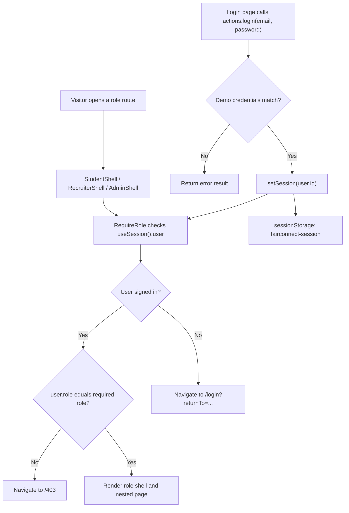

# Authentication and role protection

Sources: `src/store/store.js`, `src/components/shared/Guards.jsx`, `src/app/router.jsx`.

## Confirmed behavior

- `RequireRole` redirects when there is no current user and preserves the current pathname plus search in a `returnTo` query.
- A role mismatch redirects to `/403`.
- `actions.login(email, password)` searches the local demo users by normalized email and checks the stored password value, account suspension, and `emailVerified === false`.
- Successful login sets the session user ID.
- `actions.logout()` clears the per-tab session.
- Student registration checks that the email domain appears in `state.university.domains` and rejects duplicate email addresses.
- Recruiter registration creates a company with pending approval; recruiter shell shows `Pending` until the company is approved.

## Important demo limitation

This flow is client-side demo logic. A password value and role data are held in browser-side application state, and sessionStorage only stores a user ID. Do not treat these checks as production-grade authentication or authorization. Production access rules must be enforced by the backend; passwords should be securely hashed server-side and sessions/tokens managed appropriately.
