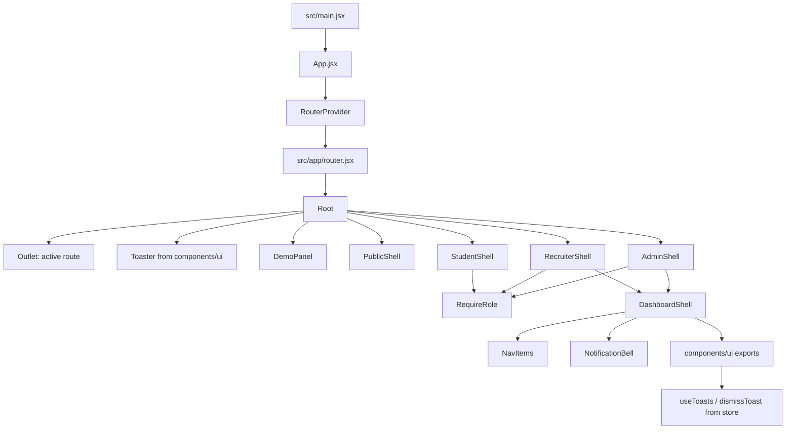

# Component architecture

This diagram focuses on confirmed shared composition. Individual page internals should be added by inspecting each page's imports; the route list is documented separately.

## Confirmed shared components

### `src/components/shared/DashboardShell.jsx`

Shared dashboard frame for recruiter/admin and any other callers. It includes:

- desktop sidebar and mobile sidebar;
- navigation links built from the `nav` prop;
- fair status indicator and optional `topLeft` content;
- notification bell;
- current-user menu and sign-out action;
- nested route `Outlet` unless explicit `children` are provided.

### `src/components/shared/Guards.jsx`

Exports `RequireRole({ role, children })`. It reads `user` from `useSession()`, redirects signed-out visitors to login with a `returnTo` query, redirects wrong-role users to `/403`, and otherwise renders children.

### `src/components/ui/index.jsx`

Central shared UI module. Inspected exports include `Logo`, `Button`, `IconButton`, `Card`, `CardHeader`, `IconTile`, `Badge`, `StatusPill`, `MatchPill`, `ScoreRing`, `ScoreBreakdown`, `ProgressBar`, `Avatar`, `CompanyLogo`, `Field`, `Input`, `Textarea`, and `Select`. It imports Motion, Lucide icons, React portal/hooks, format helpers, and toast state.

## Role shells

- `StudentShell` is the parent for student child routes.
- `RecruiterShell` applies `RequireRole role="recruiter"`, obtains context from `useRecruiter`, and renders `DashboardShell` after company approval; otherwise it renders `Pending`.
- `AdminShell` applies `RequireRole role="admin"` and renders `DashboardShell`.

## Extend this diagram

For a deeper per-page tree, inspect a page's JSX and its imports. Avoid treating every UI element inside a large page as a separate top-level route component.
