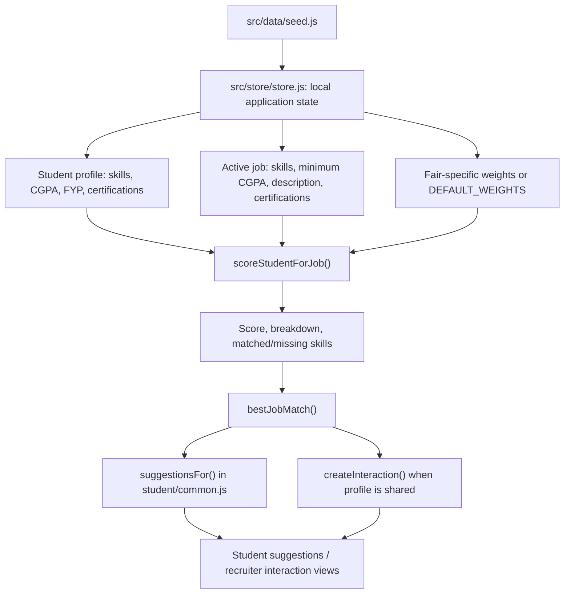

# Matching and data flow

The inspected frontend uses seeded local data and a deterministic JavaScript matching function. The source comment in `src/lib/match.js` describes it as a stand-in for a Python matching service.

## Match score factors

Default weights in `src/lib/match.js`:

| Factor | Default weight |
|---|---:|
| Skills | 40% |
| CGPA | 20% |
| FYP relevance | 25% |
| Certifications | 15% |

Per-fair weights can override the defaults. Skill names are normalized through a synonym map (for example, `js` to `javascript`, `reactjs` to `react`). FYP relevance is based on token overlap between the student's FYP text/stack and job title, description and skills. Certification matching uses simple string matching.

`bestJobMatch()` returns the highest-scoring job. `aiSummary()` produces a template summary based on the score and matched/missing skills.

## QR profile sharing

`validateShare(companyId, fairId, code)` checks that the fair/company/stall exist, the QR is active and current, the user is signed in as a student, the fair is live, required verification is satisfied, privacy settings allow sharing, and a matching interaction does not already exist. On a successful share, `createInteraction()` computes the best job match and creates an interaction with score breakdown and history.

## Current boundary

No network/API client or backend endpoint is established by the inspected files. The current flow should be understood as local demo logic. A future backend integration would replace or move persistence, authorization and trusted matching decisions to server APIs.
