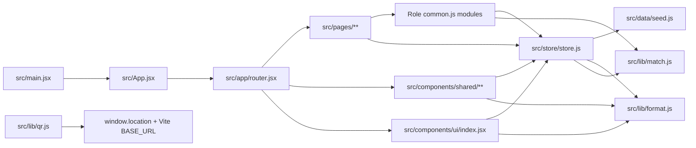

# Key files and dependency map

## Core files

| File | Responsibility |
|---|---|
| `src/main.jsx` | React DOM mount, StrictMode and global CSS import |
| `src/App.jsx` | RouterProvider entry component |
| `src/app/router.jsx` | Route tree, page imports, root wrapper, basename |
| `src/store/store.js` | Custom external store, session, persistence, actions, toast state |
| `src/data/seed.js` | Illustrative companies, jobs, users and demo records |
| `src/lib/match.js` | Skill normalization and deterministic job-match scoring |
| `src/lib/format.js` | Shared formatting/status/class-name helpers (imported by store/UI) |
| `src/lib/qr.js` | Base URL, stall URL and check-in URL helpers |
| `src/components/ui/index.jsx` | Reusable visual controls and UI primitives |
| `src/components/shared/Guards.jsx` | Role-based client route guard |
| `src/components/shared/DashboardShell.jsx` | Shared dashboard navigation/header/layout |
| `src/pages/student/common.js` | Student context and job/company suggestions |
| `src/pages/recruiter/common.js` | Recruiter/company context and chart helpers |
| `src/pages/admin/common.js` | Admin context and fair route-parameter helper |

## Package dependencies observed

From `package.json`:

- Runtime: React, React DOM, React Router, Lucide React, Motion, Recharts, QRCode React.
- Build/style: Vite, React plugin, Tailwind CSS 4, Tailwind Vite plugin, Oxfmt.
- No Redux Toolkit, Axios, Express, Mongoose or backend client appears in the inspected package manifest.

## Alias note

Source imports use the `@` alias (for example `@/store/store`). Check the Vite configuration when changing path aliases.
