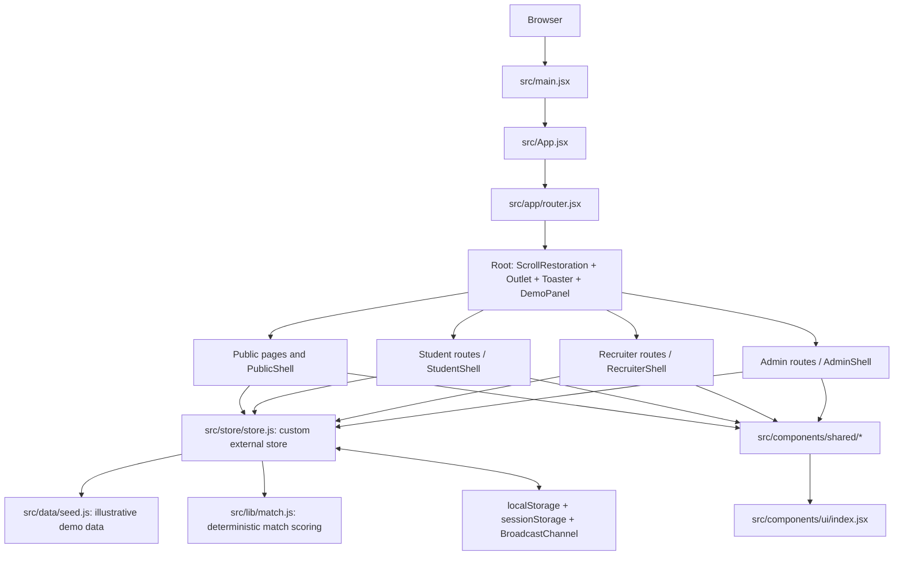

# Frontend overview

## Application composition

## Runtime entry points

1. `src/main.jsx` mounts React with `ReactDOM.createRoot`, wraps `App` in `React.StrictMode`, and imports `index.css`.
2. `src/App.jsx` renders `RouterProvider` with the router exported by `src/app/router.jsx`.
3. The router's `Root` renders scroll restoration, the current route outlet, toast UI, and `DemoPanel`.
4. Role areas render their own shell and nested pages.

## Main architectural areas

- **Public:** landing, login, registration, email verification and recovery.
- **Student:** profile, resume, company discovery, suggestions, QR/profile sharing, activity, interviews and settings.
- **Recruiter:** company/stall setup, jobs, candidate pipeline, live activity, interviews, analytics and team.
- **Admin:** fairs, companies, students, stalls, check-in, reports, AI settings, users and audit log.
- **State:** a custom external store in `src/store/store.js`, observed with React's `useSyncExternalStore`.
- **Matching:** deterministic JavaScript scoring in `src/lib/match.js`; source comment calls it a stand-in for a Python matching service.
- **Data:** seeded illustrative records from `src/data/seed.js`.

## Important limitation

The inspected code is a browser-based demo implementation with local persistence and seeded sample records. These diagrams do not imply that a live server, MongoDB, REST API, or production AI service is connected.
