# Routes and pages

Source of truth: `src/app/router.jsx`. Paths below are grouped by route family. Child paths are relative to the parent route.

```mermaid
flowchart TD
  Root["Root: ErrorElement + Toaster + DemoPanel"]
  Root --> Public["Public and utility routes"]
  Root --> Student["/student — StudentShell"]
  Root --> Recruiter["/recruiter — RecruiterShell"]
  Root --> Admin["/admin — AdminShell"]
  Public --> Landing["/"]
  Public --> Auth["/login · /register · /register/student · /register/recruiter"]
  Public --> Recovery["/verify-email · /forgot-password"]
  Public --> QR["/c/:companyId/:fairId · /fair/:fairId/checkin"]
  Public --> Error["/403 and catch-all error"]
  Student --> StudentPages["Home · onboarding · profile · resume"]
  Student --> Discovery["Fairs · companies · suggestions · scan"]
  Student --> Activity["Shared profiles · activity · interviews · prep"]
  Student --> StudentSettings["Notifications · account · privacy · feedback"]
  Recruiter --> RecruiterPages["Overview · stall · QR · jobs"]
  Recruiter --> Candidates["Pool · live dashboard · candidates · pipeline"]
  Recruiter --> RecruiterInsights["Interviews · analytics · team · settings · notifications"]
  Admin --> AdminPages["Overview · fairs · fair wizard · fair details"]
  Admin --> AdminOps["Stalls · live monitor · check-in · companies · students"]
  Admin --> AdminInsights["Analytics · reports · AI settings · users · settings · audit · notifications"]
```

## Public and utility routes

| Path | Page/component |
|---|---|
| `/` | `Landing` inside `PublicShell` |
| `/login` | `Login` |
| `/register` | `ChooseRole` |
| `/register/student` | `RegisterStudent` |
| `/register/recruiter` | `RegisterRecruiter` |
| `/verify-email` | `VerifyEmail` |
| `/forgot-password` | `ForgotPassword` |
| `/c/:companyId/:fairId` | `ShareConsent` |
| `/fair/:fairId/checkin` | `CheckIn` |
| `/403` | `ErrorPage` with code 403 |
| unmatched path | `ErrorPage` |

## Student child routes

| Relative path | Page |
|---|---|
| index | `Home` |
| `onboarding` | `Onboarding` |
| `profile` | `ProfilePreview` |
| `profile/edit` | `ProfileEdit` |
| `profile/resume` | `Resume` |
| `fairs/:fairId` | `FairDetail` (student page) |
| `companies` | `Companies` |
| `companies/:companyId` | `CompanyDetail` |
| `suggestions` | `Suggestions` |
| `scan` | `Scan` |
| `shared/:interactionId` | `Shared` |
| `activity` | `Activity` |
| `activity/:interactionId` | `InteractionDetail` |
| `interviews` | `Interviews` |
| `interviews/:id/prep` | `InterviewPrep` |
| `notifications` | `Notifications` |
| `settings` | `Account` |
| `settings/privacy` | `Privacy` |
| `feedback/:fairId` | `Feedback` |

## Recruiter child routes

| Relative path | Page |
|---|---|
| index | `Overview` |
| `stall` | `StallProfile` |
| `qr` | `StallQR` |
| `jobs` | `Jobs` |
| `jobs/new` and `jobs/:id` | `JobEditor` |
| `pool` | `PoolStats` |
| `live` | `LiveDashboard` |
| `candidates/:interactionId` | `Candidate` |
| `interviews` | recruiter `Interviews` |
| `pipeline` | `Pipeline` |
| `analytics` | `Analytics` |
| `team` | `Team` |
| `settings` | `Settings` |
| `notifications` | recruiter `Notifications` |
| unmatched child | `ErrorPage` |

## Admin child routes

| Relative path | Page |
|---|---|
| index | `Overview` |
| `fairs` | `Fairs` |
| `fairs/new` | `FairWizard` |
| `fairs/:id` | `FairDetail` |
| `fairs/:id/stalls` | `Stalls` |
| `fairs/:id/live` | `LiveMonitor` |
| `fairs/:id/checkin` | admin `CheckIn` |
| `companies` | `Companies` |
| `students` | `Students` |
| `analytics` | `Analytics` |
| `reports` | `Reports` |
| `settings` | `UniversitySettings` |
| `settings/ai` | `AISettings` |
| `users` | `Users` |
| `audit` | `Audit` |
| `notifications` | admin `Notifications` |
| unmatched child | `ErrorPage` |

Router basename uses `import.meta.env.BASE_URL`, with trailing slash removed and `/` as fallback. See `src/app/router.jsx` for exact nesting and imports.
