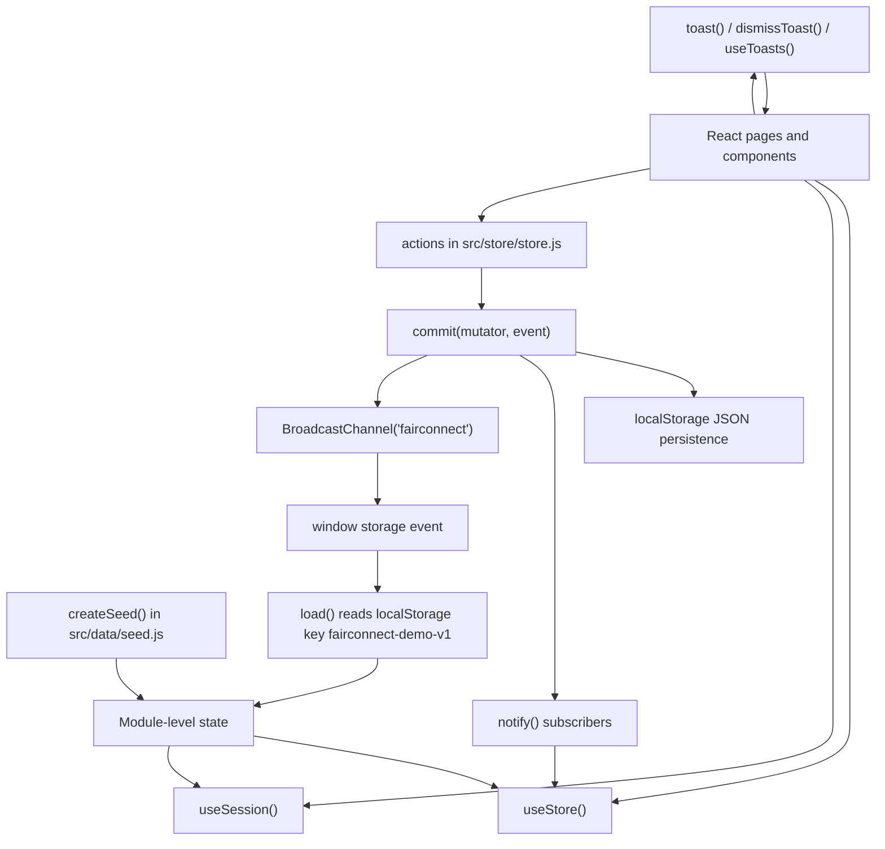

# State management and persistence

The inspected implementation uses a **custom external store**, not Redux Toolkit. React components subscribe through `useSyncExternalStore`.

## Main exports from `src/store/store.js`

- **Read state:** `getState()`, `useStore()`, `useSession()`, `getSessionUser()`.
- **Session navigation:** `homeFor(user)`.
- **Events and notifications:** `onStoreEvent()`, `toast()`, `dismissToast()`, `useToasts()`.
- **Domain helpers:** `stallFor()`, `currentFair()`, `validateShare()`.
- **Mutations:** `actions` object, including login/logout, registration and domain-specific operations.

## Persistence behavior

- Domain data key: `fairconnect-demo-v1` in `localStorage`.
- Session user ID key: `fairconnect-session` in `sessionStorage`.
- Seed data is loaded through `createSeed()` when no compatible persisted state is found.
- `commit()` clones the state, applies a mutator, writes the updated JSON, notifies subscribers and publishes an event to a `BroadcastChannel` when available.
- A browser `storage` listener reloads state when the main localStorage key changes in another tab.
- Toast messages are held in module memory and removed after a duration (default five seconds).

## How components get role-specific context

- `src/pages/student/common.js`: `useStudent()` combines `useStore()`, `useSession()`, `currentFair()`; `suggestionsFor()` scores active jobs for approved companies.
- `src/pages/recruiter/common.js`: `useRecruiter()` scopes jobs and interactions to the current recruiter/company; also exports chart constants and `useTick()`.
- `src/pages/admin/common.js`: `useAdmin()` combines store, session and current fair; `useFairParam()` selects a fair by route parameter.

## Security note

Browser storage is suitable for a prototype but is not a secure authority for real permissions or sensitive hiring records. A production system should enforce authentication and authorization on a server and persist data in a server-side database.
